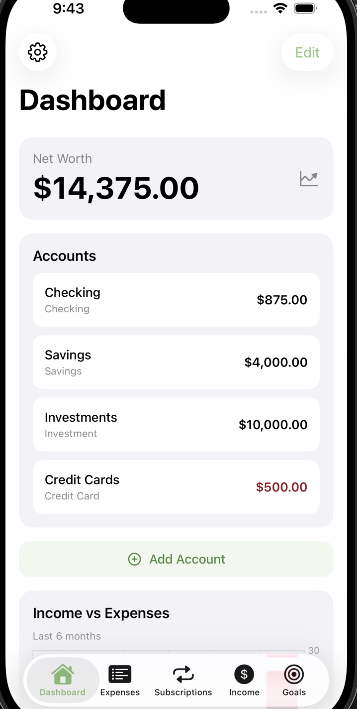
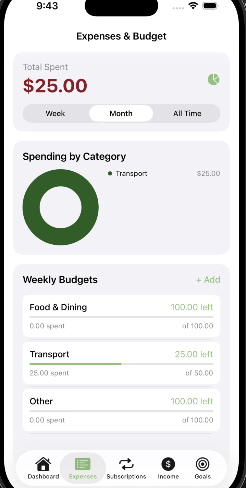
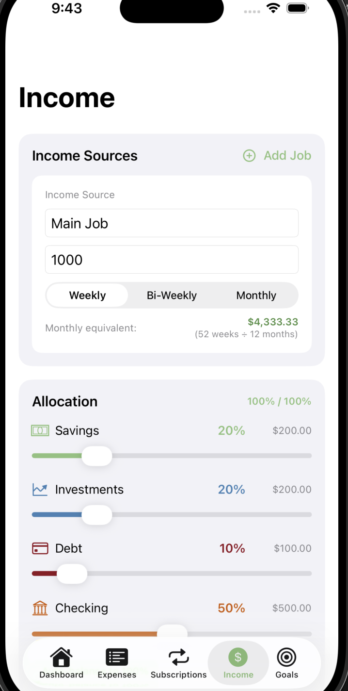
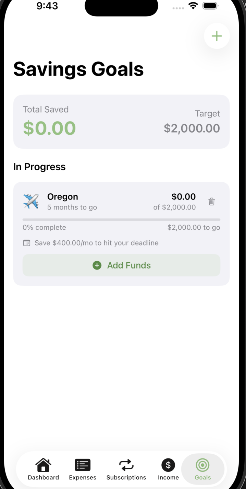
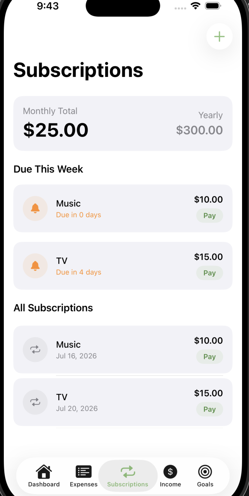

# Bilanoe

Bilanoe is a calm, personal budgeting app for iPhone built with SwiftUI and SwiftData. It is designed around a simple question: **what can I safely spend today?**

Instead of overwhelming users with charts and financial jargon, Bilanoe organizes money into four focused areas:

- **Home** — safe-to-spend amount, net worth, bills due soon, and accounts
- **Spending** — expenses, category budgets, and optional breakdowns
- **Bills** — recurring bills, due dates, and payment tracking
- **Plan** — paycheck allocation and savings goals

## Why Bilanoe?

Money is already stressful. Bilanoe keeps the important information easy to find, uses plain language, and lets users look deeper only when they need to.

## Features

### Home

- Calculates a safe-to-spend amount from checking balances and bills due this week
- Shows total net worth across checking, savings, investment, and credit-card accounts
- Adds, edits, and deletes accounts
- Keeps bills due soon visible without turning the screen into a dashboard full of charts

### Spending

- Logs expenses by amount, category, date, and account
- Updates the selected account balance when an expense is saved, edited, or deleted
- Supports weekly, monthly, and combined category budgets
- Shows the current period's spending and remaining budget at a glance
- Keeps category and spending-trend charts available behind an optional breakdown

### Bills

- Tracks recurring bills such as rent, utilities, and subscriptions
- Prioritizes overdue and due-this-week bills
- Sends optional due-date reminders
- Marks a bill as paid, records it as an expense, deducts it from an account, and moves its due date forward

### Plan

- Plans a paycheck using a default allocation for checking, savings, investments, and debt
- Supports multiple income sources and weekly, bi-weekly, or monthly schedules
- Lets users customize allocation percentages when they want more control
- Saves an income history and supports reversing a previous paycheck distribution

### Savings Goals

- Creates personalized goals with an icon, target amount, optional deadline, and optional linked account
- Shows progress and the amount left to save
- Adds money to a goal or takes money back out
- Provides monthly contribution guidance for goals with deadlines

### Privacy and preferences

- Uses a local username/password flow with credentials stored in the Keychain
- Keeps app data on-device with SwiftData
- Includes bill reminders, haptic feedback, budget-period preferences, and a default everyday account

## Screenshots

These screenshots are current placeholders and will be updated as the UI evolves.

| Home | Spending | Plan |
| --- | --- | --- |
|  |  |  |

| Goals | Bills |
| --- | --- |
|  |  |

## Built with

- Swift
- SwiftUI
- SwiftData
- Charts
- Keychain Services
- UserNotifications
- Xcode

## Running the project

1. Clone this repository.
2. Open [Bilanoe.xcodeproj](Bilanoe.xcodeproj) in Xcode.
3. Choose an iPhone simulator or a connected iPhone.
4. Build and run the Bilanoe scheme.

## Project status

Bilanoe is actively being refined. Current work is focused on making everyday money decisions feel clearer, calmer, and less overwhelming.
